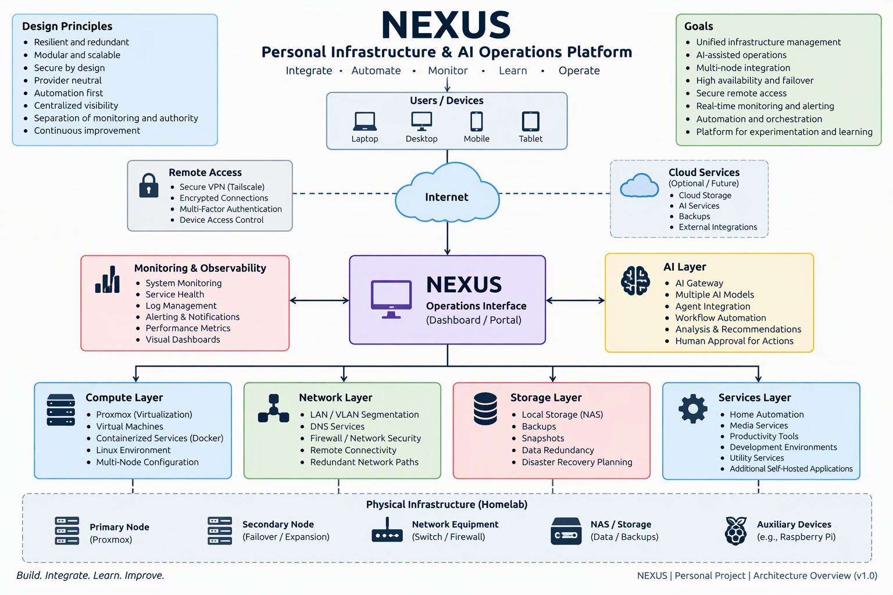
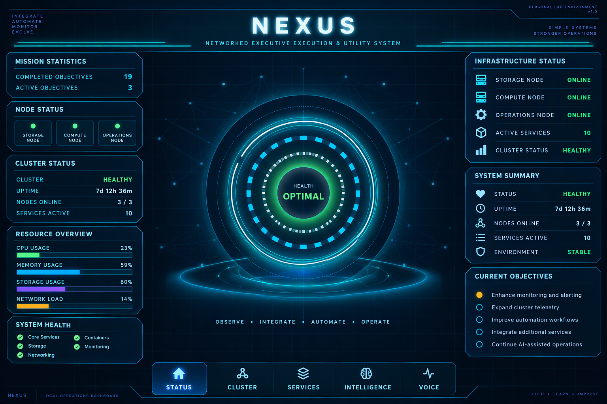

# NEXUS

### Personal Infrastructure & AI Operations Platform

NEXUS is a systems architecture and engineering project focused on integrating infrastructure, networking, automation, monitoring, and AI-assisted operations into a unified environment.

The project is designed around the same principles I use when approaching larger technical environments: understand how the individual systems interact, identify dependencies and failure points, build resilient paths, centralize operational visibility, and create an architecture that can evolve without becoming dependent on a single platform or service.
## Architecture Overview

## Operations Interface

The NEXUS operations interface provides a centralized view of infrastructure health, resource utilization, cluster status, active services, and current operational objectives.

*Sanitized operations interface. Internal addressing, credentials, security configuration, and non-public implementation details are intentionally excluded.*

## Design Goals

- Centralized infrastructure visibility
- Multi-node systems integration
- Resilient and redundant architecture
- Provider-neutral AI integration
- Secure remote connectivity
- Infrastructure monitoring
- Containerized services
- Automation and orchestration
- Modular expansion
- Clear separation between monitoring, decision-making, and system authority

## Architecture

NEXUS is built as a multi-layer environment rather than a single application.

At a high level, the platform brings together:

